### 👾 About me

- 🚨 **Founder of [RobAlert](https://www.robalert.com)**: the live map of thefts in Spain, built from neighbour reports and the day's news.
- 🎓 Studying **DAM** (Multiplatform Application Development).
- 🔭 Currently working on **RobAlert**, **Sentinel**, **Zaroz** and **Lumen**.
- 🤖 I build **Discord bots**, websites and useful tools.
- 🛡️ Trained in **cybersecurity** and **IT** with Cisco Networking Academy.
- ⚡ I ship fast with **AI**: Claude Code, Gemini and ChatGPT.

### 🎓 Education & certifications

### 🧠 AI I work with

### 💻 Tech stack

 

 

### 📊 Stats

### 🌐 Find me

